# Order Service - Workflow Diagram

%% Order Service - Step-by-Step Workflow
%% Use at https://mermaid.live to export as PNG/SVG
%%
%% HOW TO READ: Top to bottom — ① Checkout → ② Address → ③ Stock Reserved → ④ Payment Success → ⑤ Stock Confirmed → ⑥ Payment Failed → ⑦ Stock Rejected → ⑧ User Cancel
%% Each flow includes a Payload subgraph with request/response/event shapes.

```mermaid
flowchart TB
    subgraph F1["① INITIATE CHECKOUT"]
        direction TB
        FE1[🖥️ Frontend -Checkout Button-] -->|"Step 1: POST /orders/checkout"| API1[🌐 REST API]
        API1 -->|"Step 2: Idempotency-Key header"| OS1[📦 Order Service]
        OS1 -->|"Step 3: POST /products/validate-stock"| PS1[🏭 Product Service]
        PS1 -->|"Step 4: stock_validation, items, pricing"| OS1
        OS1 -->|"Step 5: Create checkout_session + items"| DB1[(🗄️ DB)]
        OS1 -->|"Step 6: order.created"| MQ1[📨 MQ]
        MQ1 -->|"Step 7: Product reserves stock"| PS1
        subgraph P1["Payload"]
            PL1A["Request: items, user_id, Idempotency-Key"]
            PL1B["order.created: checkout_id, user_id, items, delivery_address, subtotal, total"]
        end
    end

    subgraph F2["② UPDATE DELIVERY ADDRESS"]
        direction TB
        FE2[🖥️ Frontend -Place Order-] -->|"Step 1: PUT /order/checkout/{id}/address"| API2[🌐 REST API]
        API2 -->|"Step 2: Validate state"| OS2[📦 Order Service]
        OS2 -->|"Step 3: Persist delivery_address"| DB2[(🗄️ DB)]
        OS2 -->|"Step 4: Response"| FE2
        subgraph P2["Payload"]
            PL2A["Request: full_name, phone_no, email, country_code, country, city, address_line_1, ..."]
            PL2B["Response: checkout_id, address_updated_at"]
        end
    end

    subgraph F3["③ PRODUCT STOCK RESERVED"]
        direction TB
        MQ3[📨 MQ] -->|"Step 1: product.stock.reserved"| OS3[📦 Order Service]
        OS3 -->|"Step 2: InboxEvent idempotency"| DB3[(🗄️ DB)]
        OS3 -->|"Step 3: markStockConfirmed"| DB3
        OS3 -->|"Step 4: POST /payments/intents"| PAY3[💳 Payment Service]
        PAY3 -->|"Step 5: paymentId, clientSecret"| OS3
        OS3 -->|"Step 6: markPendingPayment"| DB3
        subgraph P3["Payload"]
            PL3A["product.stock.reserved: checkout_id, reservation_id, total, correlation_id"]
            PL3B["Payment Intent Request: checkout_id, reservation_id, amount, correlation_id"]
        end
    end

    subgraph F4["④ PAYMENT COMPLETED"]
        direction TB
        MQ4[📨 MQ] -->|"Step 1: payment.completed"| OS4[📦 Order Service]
        OS4 -->|"Step 2: InboxEvent idempotency"| DB4[(🗄️ DB)]
        OS4 -->|"Step 3: confirm checkout, create Order"| DB4
        OS4 -->|"Step 4: order.paid"| MQ4OUT[📨 MQ]
        MQ4OUT -->|"Step 5: Product reduces stock"| PS4[🏭 Product Service]
        subgraph P4["Payload"]
            PL4A["payment.completed: payment_id, checkout_id, order_id, reservation_id, amount"]
            PL4B["order.paid: order_id, checkout_id, deliveryAddress, items, status"]
        end
    end

    subgraph F5["⑤ PRODUCT STOCK CONFIRMED → READY FOR FULFILLMENT"]
        direction TB
        MQ5[📨 MQ] -->|"Step 1: product.stock.confirmed"| OS5[📦 Order Service]
        OS5 -->|"Step 2: InboxEvent idempotency"| DB5[(🗄️ DB)]
        OS5 -->|"Step 3: Set order status READY_FOR_FULFILLMENT"| DB5
        OS5 -->|"Step 4: order.ready_for_fulfillment"| MQ5OUT[📨 MQ]
        subgraph P5["Payload"]
            PL5A["product.stock.confirmed: checkout_id, order_id, reservation_id"]
            PL5B["order.ready_for_fulfillment: ready for packing only (no delivery yet)"]
        end
    end

    subgraph F5B["⑤b CREATE SHIPMENT (Admin)"]
        direction TB
        ADM5[👤 Admin Panel] -->|"Step 1: POST /orders/{orderId}/create-shipment"| API5B[🌐 REST API]
        API5B -->|"Step 2: Validate READY_FOR_FULFILLMENT"| OS5B[📦 Order Service]
        OS5B -->|"Step 3: Persist courier, tracking, status=SHIPPED"| DB5B[(🗄️ DB)]
        OS5B -->|"Step 4: shipment.created"| MQ5B[📨 MQ]
        MQ5B -->|"Step 5: Delivery Service creates delivery"| DS5B[🚚 Delivery Service]
        subgraph P5B["Payload"]
            PL5BA["Request: courier_code, courier_name, courier_phone, tracking_number?, tracking_url?"]
            PL5BB["shipment.created: order_id, recipient, addresses, items, courier, tracking"]
        end
    end

    subgraph F6["⑥ PAYMENT FAILED"]
        direction TB
        MQ6[📨 MQ] -->|"Step 1: payment.failed"| OS6[📦 Order Service]
        OS6 -->|"Step 2: InboxEvent idempotency"| DB6[(🗄️ DB)]
        OS6 -->|"Step 3: fail checkout"| DB6
        OS6 -->|"Step 4: order.cancelled"| MQ6OUT[📨 MQ]
        subgraph P6["Payload"]
            PL6A["payment.failed: payment_id, checkout_id, reason"]
            PL6B["order.cancelled: order_id, checkout_id, status, reason"]
        end
    end

    subgraph F7["⑦ PRODUCT STOCK REJECTED"]
        direction TB
        MQ7[📨 MQ] -->|"Step 1: product.stock.rejected"| OS7[📦 Order Service]
        OS7 -->|"Step 2: InboxEvent idempotency"| DB7[(🗄️ DB)]
        OS7 -->|"Step 3: reject checkout"| DB7
        OS7 -->|"Step 4: order.cancelled"| MQ7OUT[📨 MQ]
        subgraph P7["Payload"]
            PL7A["product.stock.rejected: checkout_id, reason"]
            PL7B["order.cancelled: order_id, checkout_id, status, reason"]
        end
    end

    subgraph F8["⑧ USER CANCEL"]
        direction TB
        FE8[🖥️ Frontend] -->|"Step 1: POST /checkout-sessions/{id}/cancel"| API8[🌐 REST API]
        API8 -->|"Step 2: Validate state"| OS8[📦 Order Service]
        OS8 -->|"Step 3: cancel checkout"| DB8[(🗄️ DB)]
        OS8 -->|"Step 4: order.cancelled"| MQ8[📨 MQ]
        subgraph P8["Payload"]
            PL8A["Request: reason (optional)"]
            PL8B["order.cancelled: order_id, checkout_id, status, reason"]
        end
    end

    subgraph F9["⑨ IDEMPOTENCY & EDGE CASES"]
        direction TB
        subgraph P9["Handling"]
            PL9A["Duplicate eventId → skip (processed_events)"]
            PL9B["Checkout not found / expired → ignore"]
            PL9C["Already PAID/CONFIRMED → ignore (payment.completed)"]
            PL9D["Invalid state for cancel → 409 Conflict"]
            PL9E["Outbox: store → publish → SENT/FAILED retry"]
        end
    end
```

## Event Flow Summary

| Event (consumed)           | Action                          | Event (published)           |
|---------------------------|---------------------------------|-----------------------------|
| —                         | Checkout initiated              | `order.created`             |
| `product.stock.reserved`  | Create payment intent, pending  | —                           |
| `payment.completed`       | Create Order, mark paid         | `order.paid`                |
| `product.stock.confirmed` | Set READY_FOR_FULFILLMENT       | `order.ready_for_fulfillment`|
| —                         | Admin create shipment           | `shipment.created`          |
| `payment.failed`         | Fail checkout                   | `order.cancelled`           |
| `product.stock.rejected` | Reject checkout                 | `order.cancelled`           |
| —                         | User cancel                     | `order.cancelled`           |

## API Endpoints

| Method | Path                               | Description                    |
|--------|------------------------------------|--------------------------------|
| POST   | /api/orders/checkout               | Initiate checkout              |
| PUT    | /api/order/checkout/{id}/address   | Update delivery address        |
| GET    | /api/orders/checkout-sessions/{id}| Get checkout status           |
| POST   | /api/orders/{orderId}/create-shipment | Create shipment (admin)     |
| POST   | /api/orders/checkout-sessions/{id}/cancel | Cancel checkout        |
